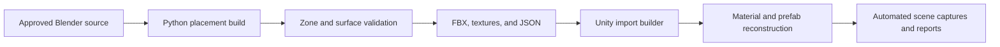
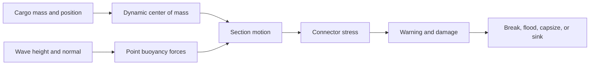

# This Will Float

**Procedural environment and modular watercraft physics R&D**<br>
Unity · C# · Blender · Python

This Will Float is a technical game prototype exploring two engineering problems:

1. How can a large stylized environment move from Blender to Unity through a deterministic, verifiable pipeline?
2. How can a modular raft communicate weight, balance, structural stress, flooding, and failure through physics?

The project is presented as an engineering prototype rather than a shipped commercial game. The focus is reproducibility, tools, simulation, and evidence-backed iteration.

> **Active environment work:** [`agent/r70-unity-migration`](https://github.com/KoA-Games/ThisWillFloat/tree/agent/r70-unity-migration)<br>
> **Technical case study:** [Engineering Case Study](docs/engineering-case-study.md)

## At a glance

| Area | Demonstrated result |
| --- | --- |
| Procedural environment | 2,098 vegetation placements generated from 166 reusable mesh prototypes |
| Deterministic validation | Preserved a fingerprint of 1,668 prior placements while adding 430 transition objects |
| Placement QA | Automated checks reported zero floating, buried, zone-mismatched, or rock-zone additions |
| DCC-to-engine transfer | Exported geometry, transforms, vertex colors, UVs, normals, camera, lighting, and material metadata from Blender to Unity |
| Physics prototype | Multi-point buoyancy, sampled wave normals, dynamic center of mass, flooding, capsizing, and stress-driven connector failure |

## Case study 1 — deterministic Blender-to-Unity environment pipeline

The environment workflow treats scene construction as a repeatable data pipeline instead of a sequence of manual edits.



Key engineering decisions:

- Seeded placement and stable fingerprints make generated layouts reproducible.
- Surface sampling uses terrain position, normal, height, slope, and material-zone data.
- Independent verification checks source preservation, transform fingerprints, placement counts, grounding, and render outputs.
- Approved `.blend` sources are treated as immutable; export runs operate on working copies and compare hashes before and after execution.
- Blender procedural materials are translated into an explicit Unity URP strategy using exported colors, textures, and metadata.

Evidence:

- [Independent R70 verifier](https://github.com/KoA-Games/ThisWillFloat/blob/agent/r70-unity-migration/This%20will%20float%20DEMO/Blender/Volcano/verify_color_zone_transitions_r70.py)
- [Deterministic cluster placement](https://github.com/KoA-Games/ThisWillFloat/blob/agent/r70-unity-migration/This%20will%20float%20DEMO/Blender/Volcano/build_color_zone_cluster_placement_r69.py)
- [Verification report](https://github.com/KoA-Games/ThisWillFloat/blob/agent/r70-unity-migration/This%20will%20float%20DEMO/Blender/Volcano/ColorZoneTransitionRefinement_R70_Renders/color_zone_transition_refinement_r70_verification.json)
- [Unity migration report](https://github.com/KoA-Games/ThisWillFloat/blob/agent/r70-unity-migration/This%20will%20float%20DEMO/Assets/_Project/R70VolcanoMigration/Source/Reports/R70_UnityMigrationExportReport.json)

<p align="center">
  
</p>

<p align="center"><em>Automated 1600×900 validation render used for placement review; not presented as final production art.</em></p>

## Case study 2 — modular raft physics and failure simulation

The raft prototype models failure as an interaction between load placement, buoyancy, joint stress, and time—not as a single scripted animation.



Implementation highlights:

- Multiple buoyancy points sample wave height and estimated surface normals.
- Lift and damping are applied at each point to produce torque as well as translation.
- Cargo updates total mass and center of mass from its local position.
- Connector stress combines mass difference, relative angle, linear velocity, and angular velocity.
- Flooding and failure expose tunable warning, damage, reinforcement, and recovery states.

Start with these files:

- [`BuoyancyBody.cs`](Assets/_Project/Scripts/Prototype/BuoyancyBody.cs)
- [`WaveSurface.cs`](Assets/_Project/Scripts/Prototype/WaveSurface.cs)
- [`RaftSection.cs`](Assets/_Project/Scripts/Prototype/RaftSection.cs)
- [`SectionConnector.cs`](Assets/_Project/Scripts/Prototype/SectionConnector.cs)
- [`FailurePrototypeController.cs`](Assets/_Project/Scripts/Prototype/FailurePrototypeController.cs)

## Repository map

```text
Assets/_Project/Scripts/Prototype/     Modular raft and buoyancy prototype
This will float DEMO/Assets/_Project/  Runtime and Unity editor tooling
This will float DEMO/Blender/           Blender source, automation, reports, and validation renders
docs/                                   Recruiter-oriented engineering case studies
```

The repository contains multiple Unity experiments and historical iterations. The links above identify the authored systems most relevant to technical review.

## Authorship and third-party assets

The engineering work highlighted here is the custom C#, Unity editor tooling, Blender Python automation, validation logic, reports, and integration workflow under `_Project` and the linked Blender scripts.

The repository also contains third-party art and presentation packages, including water, sky, vegetation, rocks, props, and scan assets. Those packages remain the work of their respective authors and are not claimed as original KoA Games technology. See [Third-Party Scope](docs/third-party-scope.md) for the review boundary.

## Project status

This is an experimental prototype. Current work prioritizes pipeline correctness, environment transfer, and physics behavior. A future performance case study will profile the dense vegetation scene, establish a GPU baseline, and compare instancing, LOD, batching, and culling changes under identical capture conditions.
